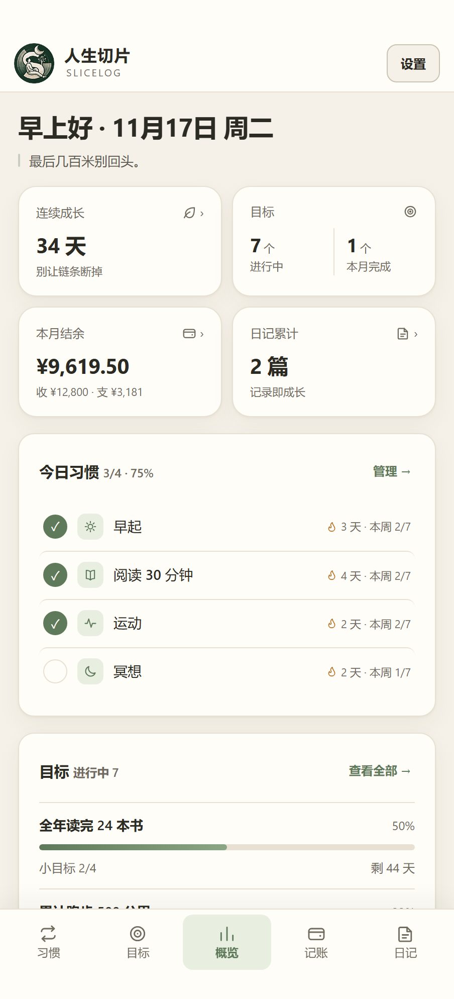
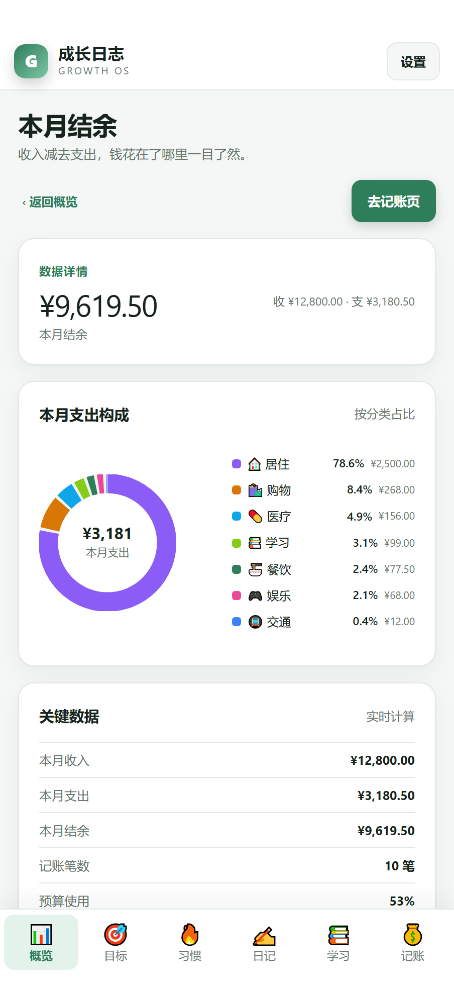
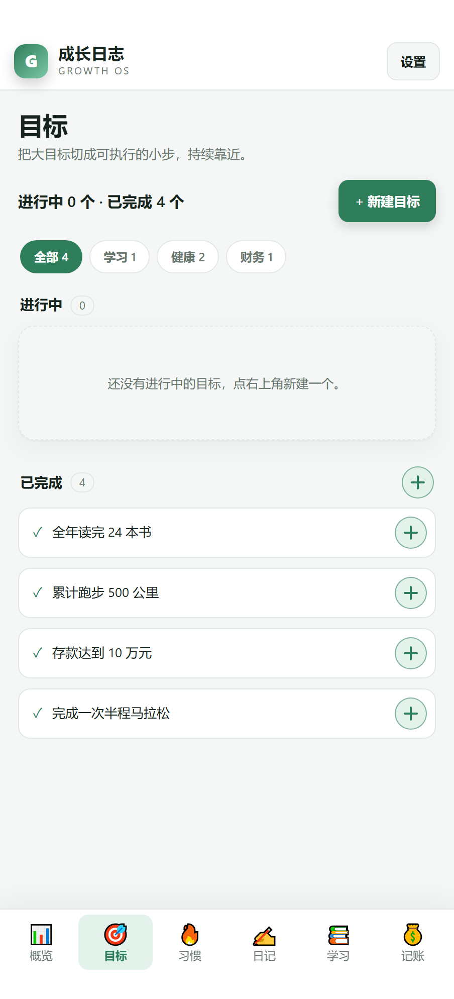
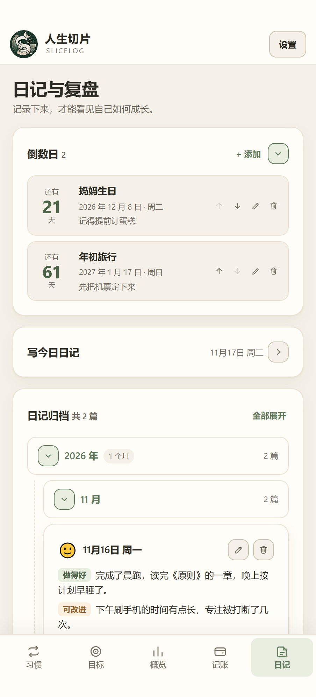
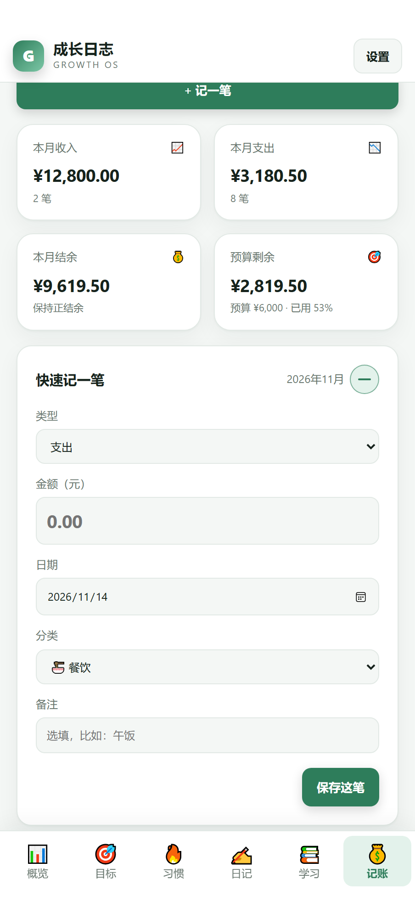
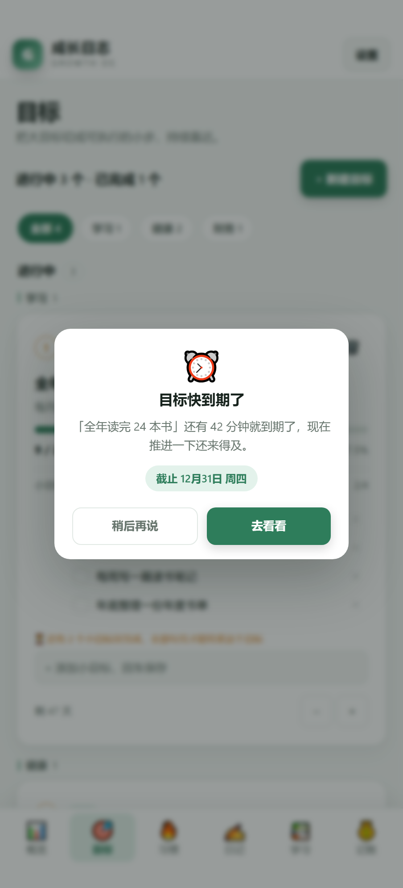

# 人生切片 · Slicelog

> 原名「成长日志 Growth OS」。一个完全离线的个人成长看板：习惯、目标、日记、学习、记账，装进一部手机。数据只存在本机，不联网、不注册、不上传。
>
> 仓库含两端：`Android 原生外壳（WebView）` 与 `iOS 可添加到主屏幕的 PWA`。二者共用同一套界面逻辑，数据格式互通。


> **下载安装**：到 [Releases](https://github.com/Bacondam/slicelog/releases) 取最新 APK；也可以按下方「构建」一节自行编译。
>
> **iPhone**：把 `ios/` 部署到任意静态托管，Safari 打开后「添加到主屏幕」，全程无需上架 App Store（详见「iOS / Web 版」）。
>
> 注意：Release 里的 APK 由 GitHub Actions 用 runner 的临时调试签名编译，和自己在本机 `assembleDebug` 出来的签名不同，
> 两者不能互相覆盖安装（换装需先卸载，数据请先导出备份）。一直用同一个来源升级则不受影响。

---

## 截图

| 概览 | 数据详情 | 目标 |
|---|---|---|
|  |  |  |

| 日记（年月折叠） | 记账 | 到期提醒 |
|---|---|---|
|  |  |  |

---

## 功能

**概览**
- 五张统计卡（连续成长、本月学习、目标进度、日记累计、本月结余），点任意一张进入独立分析页
- 成长热力图、今日习惯速览、最近日记

**目标**
- 大目标可拆多个小目标，**必须勾完全部小目标才能标记完成**，否则会提示还差几个
- 支持分类与筛选、截止日期与截止时间
- 完成后标题划线、整体灰显，自动落到「已完成」区，并**逐条折叠成一行**，点箭头单独展开
- **到期前 1 小时提醒**：前台弹应用内提醒层，App 关闭或后台时走系统通知（精确闹钟，重启手机自动重排）

**习惯**
- 按周打卡，一周结束后自动清零进入新一周，可翻阅历史周
- 连续天数统计、每周完成度

**日记**
- 每日三问（做得好 / 可改进 / 明天），心情与标签
- 按 **年 → 月** 两级归档折叠；写作区默认收起，存完立刻收回、把刚写的那篇露出来，想写再点箭头

**学习**
- 三类项目各有各的记录方式：**阅读**记读到第几页、**课程**记完成到第几讲、**技能**记练习时长 + 熟练度星级
- 页码 / 讲数一填就自动推进项目进度（进度条与「这次 +N 页 · 完成后 X%」实时联动）
- 记录里保留每次的页码或星级，最近记录一眼能看出推进了多少

**记账**
- 收入 / 支出记账，支持分类、月度与年度两种总览
- 分类图标全部为线性 SVG（碗、车、袋、房、播放、药、书、礼物…），行内编辑 / 删除与目标页同一规格
- 月度支出构成**环形图**（低饱和自然色区分，图例显示金额与占比）
- 顺序按「记完就看」排：本月统计 → 快捷记一笔 → **账单明细** → 本月小结，明细不再压在最底下
- 快捷记一笔 / 账单明细 / 本月小结 / 支出分类都是可折叠卡片，收起后只留一行标题，状态会记住

**主题**
- 五套配色：燕麦·苔绿 / 雾霭·石青 / 陶土·亚麻 / 素纸·墨绿 / 松烟·夜
- 每套只有 1 个强调色 + 3 级中性色；可交互元素（按钮、输入框、折叠箭头）用比结构线更亮一档的描边，暗色下也看得清
- 下拉框全部自绘，不再调系统列表（系统列表在深色下会白底浅字）；选项面板跟随主题
- 全量对比度受测试保护：五套主题 × 六个视图，正文最低 4.65:1、控件描边最低 1.55:1

**数据安全**
- 每次改动自动快照到应用私有目录（按天保留 8 份），可一键恢复
- 导出 JSON 备份（自选保存位置）
- **分享备份**：写入「下载/GrowthOS」并拉起系统分享面板，可直接发微信给自己
- **从微信直接导入**：在微信里点开 `.json` 备份文件 → 右上角「用其他应用打开」→ 选 **Slicelog**，
  自动校验并恢复，不用先另存到文件管理器再手动挑
- 导入备份恢复数据（应用内也可手动选择文件）

---

## 技术实现

刻意做得很小：**一个 Activity + 一个 HTML 文件**，没有任何第三方依赖、CDN 或网络请求。

| 部分 | 说明 |
|---|---|
| 外壳 | 单 `Activity` 承载 `WebView`，全部 UI 在 `app/src/main/assets/index.html`（HTML + CSS + 原生 JS，手写 SVG 图表） |
| 数据 | `localStorage`，单键 `growth-os-v1`，`normalizeState()` 负责老数据迁移 |
| 桥接 | `AndroidBridge`（`@JavascriptInterface`）：安全区、系统栏配色、文件导出、分享备份、打开系统设置 |
| 安全区 | WebView 中 `env(safe-area-inset-*)` 恒为 0，改为原生读取 `WindowInsets`（R+ `systemBars()+displayCutout()+ime()`，低版本 `getSystemWindowInset*`），写入 CSS 变量 `--sat/--sar/--sab/--sal` |
| 深色模式 | `values-v29/styles.xml` 关闭 `forceDarkAllowed`，避免 ColorOS / MIUI 二次反色破坏配色 |
| 输入缩放 | 锁定 `textZoom`，输入控件字号 ≥16px，防止聚焦时整页放大 |
| 提醒 | `AlarmManager.setExactAndAllowWhileIdle` + `BroadcastReceiver` 发通知，`BOOT_COMPLETED` 重新排程 |

设计上只依赖系统能力，所以同一份 `index.html` 直接用浏览器打开也能跑（桌面端调试很方便）。

---

## 构建

环境要求：**JDK 17** + **Android SDK Platform 35**（Build-Tools 35.0.0）。

```bash
git clone https://github.com/Bacondam/slicelog.git
cd slicelog

# 指定 SDK 位置（或设置 ANDROID_HOME 环境变量）
echo "sdk.dir=/path/to/Android/Sdk" > local.properties

./gradlew assembleDebug        # Windows: gradlew.bat assembleDebug
```

产物：`app/build/outputs/apk/debug/app-debug.apk`

Release 包需要自备签名：

```bash
./gradlew assembleRelease
```

> 国内网络若卡在 Gradle 下载，把 `gradle/wrapper/gradle-wrapper.properties` 里的
> `distributionUrl` 换成镜像，例如
> `https\://mirrors.cloud.tencent.com/gradle/gradle-8.9-bin.zip`。

---

## iOS / Web 版（PWA）

`ios/` 是一份**纯静态站点**，没有构建步骤、没有依赖：`index.html` + `manifest.webmanifest` + `sw.js` + 图标。
丢到任何静态托管（GitHub Pages、Nginx、对象存储、内网服务器）就能用；iPhone 用 Safari 打开后「添加到主屏幕」，即为全屏 App，无地址栏。

```bash
cd ios
node tools/build-dist.cjs     # 生成 dist/
node tools/serve.cjs          # 本地预览 http://127.0.0.1:8773/
```

添加到主屏幕：Safari 打开站点 → 底部「分享」→「添加到主屏幕」。首次打开后 `sw.js` 会缓存全部资源，断网也能用。

**和 Android 版的差异**

| 能力 | Android | iOS PWA |
|---|---|---|
| 系统通知 / 到期提醒 | ✅ AlarmManager 精确闹钟 | ❌ 只有前台应用内提醒 |
| 安全区适配 | 原生 WindowInsets 写 CSS 变量 | ✅ `env(safe-area-inset-*)` 原生生效 |
| 导出 / 分享备份 | ✅ 系统文件选择器 + 分享面板 | ✅ `navigator.share` |
| 微信里点开备份直接导入 | ✅ intent-filter | ⚠️ 只能在 App 内手动选文件 |
| 数据持久性 | 应用沙箱，卸载即删 | Safari 存储，清网站数据即删 |

两边 `localStorage` 键一致（`growth-os-v1`），JSON 备份可互相导入。

`ios/tools/` 里另有 `iphone-check.cjs`（iPhone 15 视口自检）与 `live-check.cjs`（线上地址自检），
依赖 Windows + Edge 的无头模式；`icon-gen.cjs` 从 `icon-src.html` 重新渲染全套尺寸图标。

---

## 目录结构

```
slicelog/
├── app/                                # Android
│   ├── build.gradle
│   └── src/main/
│       ├── AndroidManifest.xml
│       ├── assets/index.html           # 全部界面与业务逻辑
│       ├── java/com/growthos/journal/
│       │   ├── MainActivity.java       # WebView 外壳、安全区、桥接、备份
│       │   └── GoalAlarmReceiver.java  # 到期提醒、开机重排
│       └── res/                        # 主题、图标、文案
├── ios/                                # iOS / Web（PWA，纯静态）
│   ├── index.html                      # 同一套界面
│   ├── manifest.webmanifest
│   ├── sw.js                           # 离线缓存
│   ├── icons/
│   └── tools/                          # 打包、预览、自检、图标生成
├── docs/screenshots/                   # README 截图
├── tests/                              # CDP 自动化测试与截图脚本
├── gradlew / gradlew.bat
└── build.gradle
```

`tests/` 下是基于 Chrome DevTools Protocol 的无头浏览器测试，直接驱动 `index.html`，
覆盖布局适配、删除确认、目标门禁、折叠状态等场景，可用 Node 18+ 运行：

```bash
node tests/fit.cjs            # 多尺寸布局适配
node tests/goals-check.cjs    # 目标完成门禁与两区结构
node tests/features-check.cjs # 概览详情、习惯周重置、折叠
node tests/import-check.cjs   # 外部 json 直接导入（微信「用其他应用打开」）
node tests/theme-audit.cjs    # 五套主题 × 全部视图/弹窗的对比度审计
node tests/contrast.cjs       # 主题令牌 WCAG 对比度
```

---

## 隐私

- 无网络权限，App 无法联网，也就不存在上传
- 无账号、无统计 SDK、无广告
- 所有数据存于本机应用沙箱；卸载或系统「清除数据」会一并删除，请定期导出备份

---

## 已知限制

- 不支持多设备同步（离线优先的取舍）
- 提醒依赖系统「精确闹钟」权限；部分系统会限制后台自启，需要在设置里放行
- 仅针对手机竖屏优化，平板为自适应布局

---

## License

[MIT](LICENSE)
